<picture>
  <source media="(max-width: 600px)" srcset="assets/hero-mobile.svg">
  
</picture>

I build software for accounting and business operations: APIs, document workflows,
financial automation and web interfaces. My work connects business rules, databases
and applied AI, with a focus on validation, traceability and human review.

Based in Brazil. Interested in remote software development and automation projects.

[Portfolio](https://theo-moron-portfolio.pages.dev/) · [LinkedIn](https://www.linkedin.com/in/theo-moron-07904642b/) · [Email](mailto:theomoron.anastaciosilva@gmail.com)

## Selected work

### [Accounting automation](https://github.com/TheoMAS23/ai-accounting-automation)

**Public architecture case study · Private implementation**

Workflows for processing financial inputs, handling classification exceptions and
preparing structured accounting entries. My work includes n8n orchestration,
explicit validation rules and review stages for uncertain cases.

**Technology:** n8n, JavaScript, AI-assisted workflows. The public repository
documents the approach with synthetic examples; it contains no runnable workflow
or client data.

### Accounting audit platform

**Private · Development and validation**

An application for reviewing accounting statements, reconciling transactions and
proposing adjustments that require human approval. My work includes import
validation, domain logic, API development and a React interface. Versioned
criteria and historical snapshots make changes easier to inspect.

**Technology:** Python, FastAPI, SQLAlchemy, React, TypeScript. Compatibility with
real ERP exports is still being validated.

### Document operations platform

**Private · Development and test environments**

A system for tracking document intake, review, pending items and access by company.
My work covers domain services, REST APIs, PostgreSQL persistence and operator
interfaces, supported by permission checks and audit trails.

**Technology:** Python, FastAPI, PostgreSQL, SQL. Automated tests cover domain
behavior, API contracts, access boundaries and database integration.

### [Websites and digital experiences](https://theo-moron-portfolio.pages.dev/)

**Public portfolio · Delivered work and clearly labeled concept demos**

Business websites with attention to content, responsive layout and usability.
The portfolio distinguishes a delivered photography website, built and customized
with Pixieset, from fictional concept demos.

**Technology:** HTML, CSS, JavaScript; platform customization where appropriate.

Private work is described only at a high level. Internal repositories, client
records and confidential business rules remain private. Development and validation
work should not be read as a production deployment.

## Technical focus

- **Backend and data:** Python, FastAPI, REST APIs, PostgreSQL, SQL, SQLAlchemy.
- **Automation and applied AI:** n8n, workflow orchestration, AI-assisted analysis,
  Google Apps Script and system integrations.
- **Web interfaces:** JavaScript, TypeScript, React, HTML and CSS.
- **Verification and delivery:** Git, GitHub, pytest, unit and integration tests,
  API contract checks and browser-based validation.

## Engineering practice

- **Explicit rules:** keep business logic inspectable and distinguish AI proposals
  from validated results.
- **Human review:** require approval where a decision can change accounting outcomes.
- **Traceability:** retain meaningful audit events, versioned changes and
  reproducible validation steps.
- **Access boundaries:** test permissions and company isolation; keep credentials
  and client data out of public artifacts.
- **Honest release status:** distinguish a synthetic demo, a test environment and
  a production deployment.

## Contact

For software development, business automation or remote collaboration:

[Explore the portfolio](https://theo-moron-portfolio.pages.dev/) · [Connect on LinkedIn](https://www.linkedin.com/in/theo-moron-07904642b/) · [theomoron.anastaciosilva@gmail.com](mailto:theomoron.anastaciosilva@gmail.com)
